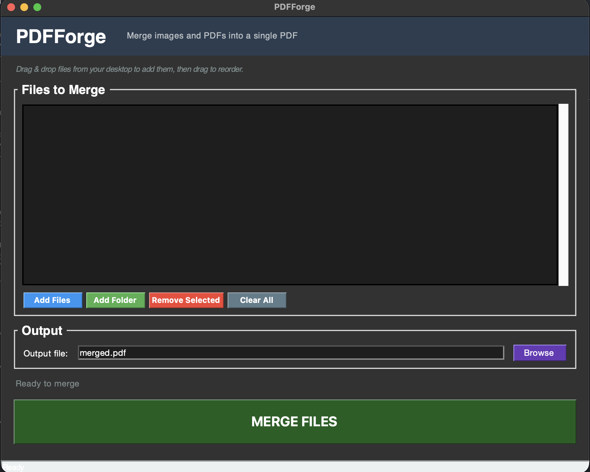

# PDFForge

PDFForge is a Python app with both Command Line Interface (CLI) and Desktop Graphical User Interface (GUI). Merge images (JPEG, PNG, etc.) and PDFs into a single PDF.



## Features

- Convert images (JPEG, PNG, GIF, BMP, TIFF, WebP) to PDF pages
- Merge PDFs and images in any order
- Drag-and-drop file reordering in GUI
- Built with [uv](https://github.com/astral-sh/uv) and [pypdf](https://pypdf.readthedocs.io/)

## Setup

Install [uv](https://github.com/astral-sh/uv) to build PDFForge's GUI and CLI executables or run it from source. uv installs the required Python version automatically; the built executables do not need uv or Python.

To build or run PDFForge from source, uv is the only manual installation needed on macOS and Windows. On Linux, the GUI also requires system Tk/X11 libraries, and building requires `binutils`.

```bash
# macOS / Linux
curl -LsSf https://astral.sh/uv/install.sh | sh
```

```powershell
# Windows (PowerShell)
powershell -ExecutionPolicy ByPass -c "irm https://astral.sh/uv/install.ps1 | iex"
```

Then install the project dependencies:

```bash
uv sync
```

## Building

Build PDFForge to create executables in `dist/` that bundle Python and its dependencies. These are plain executables and folders, not OS installers or packages such as `.dmg`, `.deb`, `.rpm`, or `.msi`. The built executables do not require Python or uv.

- To run PDFForge from source without building, use the `uv run` commands in [Run from source](#run-from-source).
- To build for Linux, use a container for Ubuntu or Fedora targets; see [Linux containers](#linux-containers).

A build produces two separate PyInstaller outputs: a GUI executable and a CLI executable. No prebuilt binaries are committed; artifacts are generated locally with `scripts/build_apps.py`. PyInstaller does not cross-compile, so build on the target OS and architecture.

### Requirements

- [uv](https://github.com/astral-sh/uv)
- Python 3.14, installed automatically by `uv`
- The target OS and architecture:
  - macOS: Apple Silicon (arm64)
  - Linux: the architecture you plan to build for
  - Windows: the architecture you plan to build for

### Build

Build both apps in one command:

```bash
uv sync && uv run python scripts/build_apps.py
```

Build them independently:

```bash
uv run python scripts/build_apps.py gui
uv run python scripts/build_apps.py cli
```

Artifacts are written to `dist/`:

| Platform | GUI | CLI |
|----------|-----|-----|
| macOS | `PDFForge.app` (bundle), `PDFForge/PDFForge` (executable) | `pdf-forge` |
| Linux | `PDFForge/PDFForge` | `pdf-forge` |
| Windows | `PDFForge/PDFForge.exe` | `pdf-forge.exe` |

A Linux build produces:

```text
dist/
├── PDFForge/
│   ├── PDFForge
│   └── _internal/
└── pdf-forge
```

`dist/PDFForge/` is a PyInstaller one-dir bundle. The executable and its `_internal/` support files must be kept together. `dist/pdf-forge` is a single-file executable.

### Run the built apps

Artifacts are run from the repository root:

```bash
# macOS / Linux
./dist/PDFForge/PDFForge
./dist/pdf-forge --help

# Windows (PowerShell)
.\dist\PDFForge\PDFForge.exe
.\dist\pdf-forge.exe --help
```

The CLI requires at least one `inputs` argument; `--help` prints usage. On macOS, PyInstaller also produces `PDFForge.app` for Finder; the executable is `dist/PDFForge/PDFForge`.

### Platform notes

- macOS: build on Apple Silicon for an arm64 executable.
- Linux: build on the target architecture. Use a container for Ubuntu or Fedora targets. The executable uses the build host's glibc and X11/Tk libraries, so build on an older distribution to support older systems. On a headless machine, `xvfb-run -a timeout 10 ./dist/PDFForge/PDFForge` confirms that the GUI starts.
- Windows: build on Windows to produce `PDFForge.exe` and `pdf-forge.exe`.

#### Linux containers

```bash
# Ubuntu
docker run --rm -it -v "$PWD":/src -w /src ubuntu:26.04 bash

# Fedora
docker run --rm -it -v "$PWD":/src -w /src fedora:latest bash
```

Add `--platform linux/amd64` or `linux/arm64` to match the target architecture.

Inside the container, use the block for your distro:

```bash
# Ubuntu
apt-get update && apt-get install -y curl ca-certificates binutils xvfb \
  libx11-6 libxext6 libxrender1 libxft2 libfontconfig1 libxss1

# Fedora
dnf install -y curl ca-certificates binutils xorg-x11-server-Xvfb \
  libX11 libXext libXrender libXft fontconfig libXScrnSaver

curl -LsSf https://astral.sh/uv/install.sh | sh
export PATH="$HOME/.local/bin:$PATH"
uv sync && uv run python scripts/build_apps.py
```

### Testing checklist

- Launch the GUI and merge a mix of images and PDFs.
- Reorder files with drag-and-drop.
- Run the CLI with individual files, a directory, and a glob pattern.
- Confirm the generated PDF opens correctly.
- Test the built applications on a clean machine or VM without Python or uv installed.
- Launch the built GUI on a clean macOS machine.

### Troubleshooting

- **PyInstaller reports missing `objdump` on Linux:** install `binutils`.
- **GUI build fails with missing Tkinter:** install the platform Tk/X11 packages or use a Python build that includes Tkinter.
- **Drag-and-drop is missing:** the build script uses `--collect-all tkinterdnd2`; verify the package data is present in the built artifact.
- **Application fails on another Linux distribution:** rebuild on a glibc version matching the target system.

## Run from source

These commands run PDFForge directly from the source checkout. No build step is required; for built executables, see [Building](#building).

### Command Line Interface (CLI)

```bash
# Merge images and PDFs
uv run python -m pdf_forge file1.jpg file2.png file3.pdf -o merged.pdf

# Use the installed entry point
uv run pdf-forge file1.jpg file2.png file3.pdf -o merged.pdf

# For help
uv run pdf-forge --help
```

### Desktop Graphical User Interface (GUI)

```bash
# Launch the GUI
uv run pdf-forge-gui
```

**Note:** The GUI requires tkinter to be available on your system. On most Linux distributions, you may need to install `python3-tk` or equivalent package.

#### GUI Features:
- Drag and drop files to reorder them
- Add individual files or entire folders
- Real-time status and progress indicators
- File type identification (PDF/Image)
- Output file location selection

### Options (CLI only)

| Option | Description |
|--------|-------------|
| `inputs` | Input files/directories or '*' glob patterns |
| `-o, --output` | Output PDF path (default: `merged.pdf`) |
| `-v, --verbose` | Show processing details |

## Development

```bash
# Run tests
uv run pytest

# Update dependencies
uv lock

# Run linting/formatting (if configured)
# uv run ruff check .  # example
```

## Project Structure

```
PDFForge/
├── src/
│   └── pdf_forge/
│       ├── __init__.py        # Core merging logic
│       ├── __main__.py        # CLI entry point
│       └── gui.py             # Desktop GUI implementation
├── scripts/                   # Build scripts for local executables
├── tests/                     # Unit tests
├── test_data/                 # Sample test files
├── pyproject.toml             # Project configuration
└── README.md                  # This file
```

## How It Works

PDFForge works by:
1. Accepting input files (images or PDFs) via CLI arguments or GUI
2. Converting images to PDF pages while preserving original dimensions
3. Appending existing PDFs as-is
4. Merging all pages into a single output PDF

Images are converted at their native resolution without resizing or stretching, maintaining their original aspect ratio and quality.
